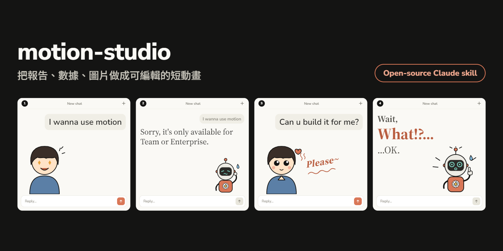

# claude-skills

我自己做、自己在用的 Claude skills。
Claude skills I built and use myself.

| Skill | 用途 / What it does |
|---|---|
| [motion-studio](motion-studio/) | 把報告、數據、圖片做成可編輯的短動畫 / Turn reports, data and images into short, editable animations |

ABAP 相關的 skill 在另一個 repo：[abap-claude-skills](https://github.com/hungyichiu/abap-claude-skills)。
ABAP skills live in a separate repo: [abap-claude-skills](https://github.com/hungyichiu/abap-claude-skills).

---

## motion-studio

想用 Claude 的 Motion 做動畫，它說只開放給 Team 和 Enterprise。那就請 Claude 自己做一個。

I wanted to use Motion in Claude. It's only available on Team and Enterprise plans. So I asked Claude to build one.

### 能做什麼 / What it does

- 把內容做成 15～30 秒的動畫：文字、數字跳動、長條圖、折線圖、清單、箭頭、圖片的進退場與轉場
- 畫面比例：16:9、9:16、1:1、4:5
- 發佈成可以直接在畫面上編輯的頁面：拖拉位置與大小、在時間軸調秒數和出場時間、換色、改字改數字，改完按儲存
- 在對話裡匯出 MP4 或 GIF

- Short animations (15–30s): text, counting numbers, bar and line charts, lists, arrows, images, with entrances, exits and transitions
- Aspect ratios: 16:9, 9:16, 1:1, 4:5
- Published as a page you edit directly: drag and resize, adjust timing on a timeline, change colors, text and numbers, then save
- Export to MP4 or GIF from the chat

做不到：3D、運鏡、寫實影片、真人、配音和背景音樂。

Not supported: 3D, camera moves, live-action footage, voice-over and music.

### 安裝 / Install

1. 下載 `motion-studio` 資料夾，壓成 zip（zip 裡是 `motion-studio/` 資料夾）。
2. 在 Claude 打開 **Customize › Skills**，按 **+** › **Create skill** › **Upload a skill**，上傳 zip。
3. 在技能清單裡把它打開。

1. Download the `motion-studio` folder and zip it (the zip contains the `motion-studio/` folder).
2. In Claude, open **Customize › Skills**, click **+** › **Create skill** › **Upload a skill**, and upload the zip.
3. Toggle it on in your skills list.

### 怎麼用 / Usage

跟 Claude 說「把這份報告做成 30 秒動畫」或「/motion」，附上報告、數據或截圖。要影片檔就說「匯出 MP4」。

Ask Claude something like "turn this report into a 30-second animation" or "/motion", and attach your report, data or screenshots. Say "export MP4" when you want a video file.

### 需求 / Requirements

- 發佈可編輯頁面需要 Claude 的 Artifact 功能。
- 匯出 MP4、GIF 需要 Python 的 `playwright`（含 Chromium）和 `ffmpeg`，skill 會先自己檢查。

- The editable page needs Claude's Artifacts.
- MP4 / GIF export needs Python `playwright` (with Chromium) and `ffmpeg`; the skill checks for them first.

### 檔案 / Files

| 路徑 / Path | 用途 / Purpose |
|---|---|
| `SKILL.md` | 給 Claude 的流程說明 / Instructions for Claude |
| `assets/engine.html` | 播放器＋編輯器 / Player and editor |
| `scripts/build.py` | 分鏡 → 可發佈頁面 / Spec → publishable page |
| `scripts/render.py` | 分鏡 → MP4、GIF、靜態圖 / Spec → MP4, GIF, stills |
| `templates/` | 說明動畫、動態圖表、直式步驟導覽範本 / Explainer, chart, vertical walkthrough |
| `references/spec-format.md` | 分鏡格式 / Spec format |

## License

[MIT](LICENSE)
